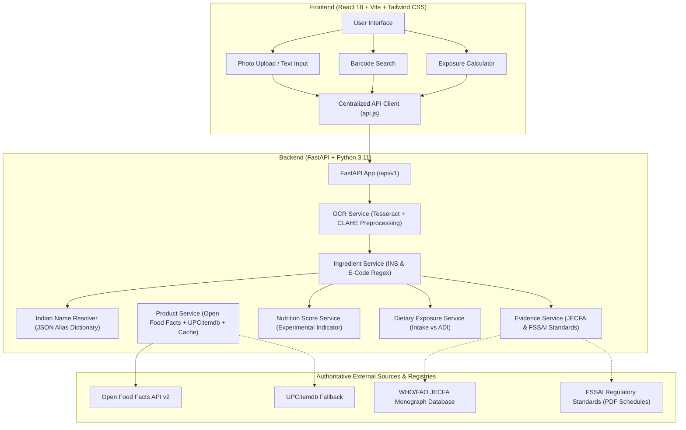

# NutriDecode AI — Food-Label Intelligence & Consumer Safety Platform

NutriDecode AI is an open, evidence-based food-label intelligence and consumer-safety platform focused on decoding packaged foods, particularly Indian products whose ingredients may be unfamiliar, regional, transliterated, or encoded in INS/E-numbers.

Unlike commercial apps that produce binary, unscientific "toxic / safe" scores, NutriDecode prioritizes:
1. **Traceable Evidence:** Linking directly to official WHO/FAO JECFA monographs and FSSAI regulatory schedules.
2. **Indian Regional Ingredient Resolution:** Mapping colloquial and regional names (e.g. *haldi*, *maida*, *uppu*, *methi*, *besan*) to canonical ingredients without hallucinated guesses.
3. **Quantitative Exposure Simulation:** Calculating intake against verified Acceptable Daily Intake (ADI) thresholds per kg of consumer body weight, clearly separated from marketing claims.
4. **Transparent Uncertainty:** Distinguishing machine OCR identification from verified scientific conclusions, and explicitly highlighting missing data or terms requiring citizen-science human review.

---

## Architecture & Data Flow



---

## Features Implemented

| Module | Feature | Implementation Details |
|---|---|---|
| **Vision & OCR** | Food-label photo upload | Validates format (JPEG, PNG, WebP), enforces 8 MB limit, verifies image buffer with Pillow. |
| **Vision & OCR** | Computer-vision preprocessing | CLAHE adaptive contrast enhancement, bilateral/Gaussian noise filtration, and aspect-ratio scaling. |
| **Vision & OCR** | Tesseract OCR engine | Configured via `TESSERACT_CMD` environment variable or system `PATH`; runs PSM 6 with PSM 3 fallback. |
| **Intelligence** | Additive code extraction | Regex pattern matching `INS\s*\d+[a-z]?(\([i|v|x]+\))?`, `E\s*\d+`, and isolated catalogue numbers. |
| **Intelligence** | Indian regional alias resolution | Curated dataset mapping Hindi, Tamil, Telugu, and Marathi ingredients (*haldi* → turmeric, *maida* → refined wheat flour, *uppu* → salt). |
| **Evidence** | WHO/FAO JECFA & FSSAI catalogue | 19 fully documented food additives with CAS, formula, ADI values, acute/chronic evaluations, and direct URLs. |
| **Exposure** | Quantitative intake calculator | Computes additive intake per serving, daily intake, body-weight normalized exposure, and percentage of ADI. |
| **Barcode** | Dual-provider lookup with cache | Queries Open Food Facts v2 with UPCitemdb fallback; caches results with in-memory TTL; flags incomplete data. |
| **Discovery** | Unknown-Product Candidate Search | Registry search across Open Food Facts for missing/damaged barcodes with data completeness scores (0–100%) and variant conflict detection. |
| **AI Assistant** | Evidence-Grounded Product Summary | Structured, plain-language explanation strictly grounded in JECFA/FSSAI evidence, with zero invented ADIs or medical safety verdicts. |
| **AI Engine** | Configurable AI Providers & Fallback | Provider abstraction supporting Google Gemini API and OpenAI-compatible endpoints with deterministic rule-based offline fallback when no key is configured. |
| **Personalization**| Consumer preferences alignment | Tailors explanations to user's requested reading style (simple/standard/technical), depth, dietary patterns, and declared exclusions. |
| **Nutrition** | Experimental Nutrition Indicator | Transparent 0–100 prototype score evaluating sugar, saturated fat, and sodium penalties with fiber/protein bonuses. |
| **Frontend** | Interactive responsive workspace | React 18 single-page application with photo drag-and-drop, editable OCR text review, candidate discovery, AI summary cards, and calculator. |

---

## Technology Stack

- **Backend:** Python 3.11, FastAPI, Uvicorn, Pydantic v2, PyTesseract, OpenCV (headless), Pillow, HTTPX, Pytest.
- **Frontend:** React 18, Vite 5, Tailwind CSS 3, Lucide React icons.
- **System Dependencies:** Tesseract-OCR v5+ (for optical character recognition).

---

## Directory Structure

```
NutriDecode/
├── .gitignore                      # Git exclusion rules for Python & Node
├── README.md                       # Main project documentation
├── backend/
│   ├── .env                        # Local runtime environment variables
│   ├── .env.example                # Example backend configuration
│   ├── requirements.txt            # Python dependencies
│   ├── app/
│   │   ├── main.py                 # FastAPI application factory & CORS
│   │   ├── api/
│   │   │   ├── analyze.py          # Combined analysis & /ai-summary endpoints
│   │   │   ├── evidence.py         # Additive catalogue & evidence endpoints
│   │   │   ├── exposure.py         # Quantitative dietary exposure endpoints
│   │   │   ├── health.py           # Health check endpoint
│   │   │   ├── ingredients.py      # Ingredient parsing & alias resolution
│   │   │   ├── ocr.py              # OCR extraction endpoint
│   │   │   └── products.py         # Barcode lookup & /search candidate discovery
│   │   ├── core/
│   │   │   └── config.py           # Pydantic BaseSettings, AI provider settings & CORS
│   │   ├── data/
│   │   │   └── indian_ingredient_aliases.json # 500+ regional alias records
│   │   ├── services/
│   │   │   ├── ai_provider.py      # BaseAIProvider, GeminiProvider, OpenAI, Mock provider
│   │   │   ├── ai_summary_service.py # Evidence-grounded summary & deterministic fallback
│   │   │   ├── evidence_service.py # JECFA & FSSAI structured evidence records
│   │   │   ├── exposure_service.py # Exposure & ADI calculation algorithms
│   │   │   ├── indian_name_service.py # Alias matching & normalization logic
│   │   │   ├── ingredient_service.py  # Label parsing & code extraction
│   │   │   ├── nutrition_score_service.py # Experimental nutrition score
│   │   │   ├── ocr_service.py      # CLAHE preprocessing & Tesseract wrapper
│   │   │   ├── product_discovery_service.py # Unknown-product candidate discovery & scoring
│   │   │   └── product_service.py  # Open Food Facts & UPCitemdb integration
│   │   └── tests/                  # 50 automated pytest unit & integration tests
│   │       ├── test_ai_summary.py  # AI summary schema, mock, caching, fallback tests
│   │       ├── test_discovery.py   # Completeness, conflicts, candidate search tests
│   │       └── ...                 # Baseline tests for all pipeline stages
└── frontend/
    ├── .env                        # Local frontend environment variables
    ├── .env.example                # Example frontend configuration
    ├── index.html                  # Root HTML template
    ├── package.json                # Node dependencies & build scripts
    ├── tailwind.config.js          # Brand palette & typography configuration
    ├── vite.config.js              # Vite bundler & dev proxy configuration
    └── src/
        ├── App.jsx                 # Application shell & tab navigation
        ├── main.jsx                # React DOM entry point
        ├── index.css               # Tailwind CSS & typography imports
        ├── services/
        │   └── api.js              # Centralized API client with timeouts
        └── components/
            ├── AnalyzeWorkspace.jsx # Photo upload, OCR review, results view
            ├── AnveshanaTab.jsx    # Citizen science student framework
            ├── BarcodeLookup.jsx   # Live barcode search & completeness check
            ├── EvidenceCatalogue.jsx# Additive search & JECFA/FSSAI viewer
            ├── ExposureCalculator.jsx# Quantitative ADI exposure simulator
            ├── Footer.jsx          # Traceable links & safety disclaimer
            ├── HomeTab.jsx         # Landing page, pipeline overview, samples
            └── Navbar.jsx          # Header with live API health indicator
```

---

## Local Setup & Run Guide

### 1. Prerequisites
- **Python:** 3.11 or newer
- **Node.js:** 18.x or newer & npm
- **Tesseract-OCR:** Installed on host machine.
  - *Windows:* Download installer from [UB-Mannheim/tesseract](https://github.com/UB-Mannheim/tesseract/wiki) (default: `C:\Program Files\Tesseract-OCR\tesseract.exe`).
  - *Linux (Ubuntu/Debian):* `sudo apt-get install tesseract-ocr`
  - *macOS:* `brew install tesseract`

### 2. Backend Setup
Navigate to the `backend/` directory:
```powershell
cd backend
py -3.11 -m venv .venv
.\.venv\Scripts\Activate.ps1
python -m pip install --upgrade pip
python -m pip install -r requirements.txt
```

Verify or configure your `.env` file (copied from `.env.example`):
```ini
APP_NAME=NutriDecode API
APP_VERSION=0.1.0
APP_ENV=development
API_V1_PREFIX=/api/v1
FRONTEND_ORIGINS=http://localhost:3000,http://localhost:5173,http://127.0.0.1:3000,http://127.0.0.1:5173
TESSERACT_CMD=C:\Program Files\Tesseract-OCR\tesseract.exe
```

Run the backend server:
```powershell
python -m uvicorn app.main:app --reload --port 8000
```
- API Base: `http://127.0.0.1:8000/`
- Health check: `http://127.0.0.1:8000/api/v1/health`
- Swagger Interactive Docs: `http://127.0.0.1:8000/docs`

### 3. Frontend Setup
In a new terminal, navigate to the `frontend/` directory:
```powershell
cd frontend
npm install
```

Ensure `frontend/.env` is configured:
```ini
VITE_API_BASE_URL=http://localhost:8000/api/v1
```

Run the development server:
```powershell
npm run dev
```
Open your browser at `http://localhost:5173/`.

---

## Running Automated Tests

All tests are designed to run offline without requiring external network access (external APIs are mocked).

### Run Backend Tests (50 passing tests):
```powershell
cd backend
.\.venv\Scripts\python.exe -m pytest -v
```

### Run Frontend Production Build:
```powershell
cd frontend
npm run build
```

---

## API Endpoints Reference

| Method | Endpoint | Description |
|---|---|---|
| `GET` | `/` | Basic API root information. |
| `GET` | `/api/v1/health` | Health check reporting status, app version, and environment. |
| `POST` | `/api/v1/ocr/extract` | Uploads an image file and extracts raw OCR text using Tesseract. |
| `POST` | `/api/v1/ingredients/analyze` | Parses ingredient text, extracts additive codes, and flags unknown terms. |
| `GET` | `/api/v1/ingredients/resolve-name` | Resolves an Indian regional ingredient alias to its canonical English term. |
| `POST` | `/api/v1/analyze/image` | End-to-end pipeline: image upload → OCR → parsing → aliases → evidence → nutrition. |
| `POST` | `/api/v1/analyze/text` | Direct text pipeline: parses corrected label text without re-uploading an image. |
| `POST` | `/api/v1/analyze/ai-summary` | Generates evidence-grounded, personalized AI product summary with provider abstraction & fallback. |
| `GET` | `/api/v1/evidence` | Lists all documented food additive evidence records. |
| `GET` | `/api/v1/evidence/{code}` | Retrieves JECFA evaluations, FSSAI regulations, and ADI for an additive code. |
| `POST` | `/api/v1/exposure/calculate` | Calculates additive exposure and ADI percentage given concentration, serving size, and body weight. |
| `GET` | `/api/v1/exposure/reference-adi/{code}` | Looks up the verified JECFA ADI reference value for an additive code. |
| `GET` | `/api/v1/exposure/reference-adis` | Lists all additives with available ADI reference values. |
| `GET` | `/api/v1/products/barcode/{barcode}` | Looks up product details in Open Food Facts with UPCitemdb fallback and in-memory TTL cache. |
| `GET` | `/api/v1/products/search` | Discovers candidate products from public registries with completeness scores and conflict detection. |

---

## Scientific Evidence & Safety Disclaimers

> [!IMPORTANT]
> **NutriDecode AI is an educational food-literacy and preliminary evidence-screening prototype.**
> - **Identification is not toxicity:** The presence of an approved additive (e.g. INS 330 citric acid or INS 500ii sodium bicarbonate) does not indicate a health hazard.
> - **Hazard vs. Risk:** Chemical hazards observed under extreme concentrated laboratory conditions do not represent risk at approved parts-per-million levels in food matrices.
> - **Concentration limitation:** Packaged food labels list ingredients in descending order of weight, but rarely declare exact numeric concentrations. Exposure estimates require laboratory verification or statutory maximum limits.
> - **Not medical advice:** NutriDecode AI does not diagnose allergies, food sensitivities, or clinical toxicity. Consult qualified healthcare professionals for dietary requirements.
